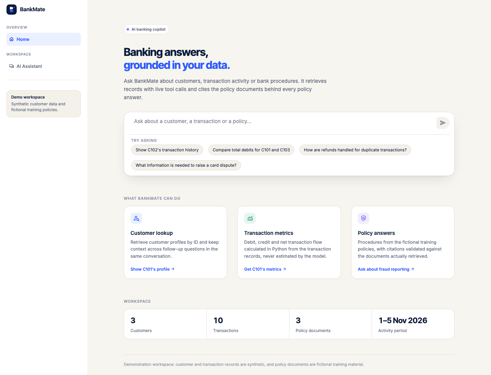
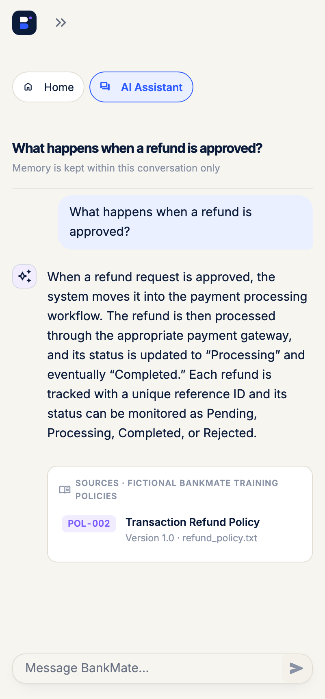
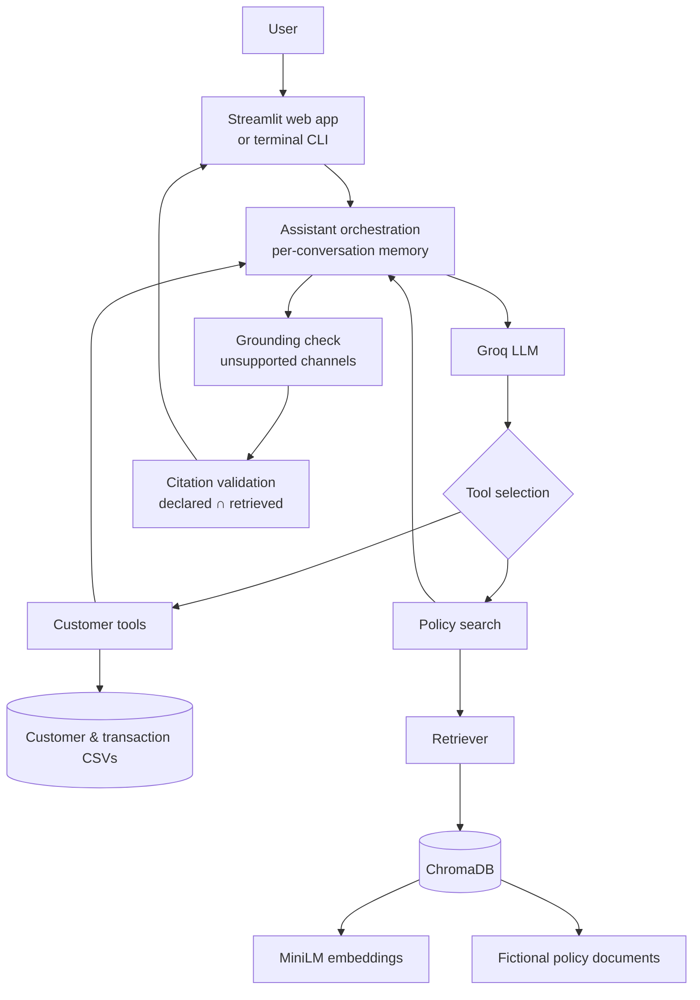

# BankMate — AI Banking Copilot

A conversational banking assistant built with **LangChain, Groq and Retrieval-Augmented Generation (RAG)**. BankMate answers questions about customers, transaction activity and bank procedures by calling tools over structured data and retrieving evidence from policy documents. Every policy answer cites the documents it relied on, and those citations are validated against what was actually retrieved.

> **Status:** Active development
> **Data:** Synthetic customer and transaction records; fictional banking policies

<p align="center">
  
</p>

---

## Highlights

- **Web app** — a Streamlit workspace with a home page, a multi-conversation AI assistant, responsive layouts and a consistent design system.
- **Tool calling** — the model retrieves customer profiles and transactions and computes debit, credit and net transaction flow in Python rather than estimating figures.
- **RAG over policy documents** — section-aware chunking, Sentence Transformer embeddings and ChromaDB retrieval with a similarity-distance threshold.
- **Validated citations** — the model declares which policies it used; BankMate keeps only IDs that were actually retrieved in that turn, and shows no sources when an answer isn't supported by the policies.
- **Grounding check** — contact channels (phone, chat, branch, email, app…) that don't appear in the retrieved evidence trigger a revision before the answer is shown.
- **Isolated conversation memory** — follow-ups such as "what was *his* total debit?" resolve within a conversation; separate conversations never share context.
- **Tested** — offline pytest suite with fake models and tools, plus Streamlit `AppTest` UI tests. No API key needed to run it.

## Screenshots

| AI Assistant with validated sources | Mobile |
|---|---|
|  |  |

## Architecture



### Answer pipeline

1. The model chooses tools; customer tools read the CSVs, and `search_banking_policies` retrieves policy chunks within a distance threshold.
2. For policy answers, the model ends its reply with `CITED_POLICIES: POL-xxx` or `CITED_POLICIES: NONE`.
3. **Grounding check** (`app/grounding.py`): contact channels named in the answer are compared with the retrieved evidence and customer data. Unsupported ones trigger one revision; remaining example lists are removed without deleting whole sentences.
4. **Citation validation** (`app/citations.py`): declared IDs are intersected with the sources retrieved in that turn. A missing marker or `NONE` yields no sources (fail closed), so fabricated or unused policies are never shown.
5. The UI renders the answer and policy-level sources with the fictional-policy disclaimer.

## Technology stack

| Area | Technology |
|---|---|
| Language | Python 3.9+ |
| LLM orchestration | LangChain |
| LLM provider / model | Groq · `openai/gpt-oss-20b` |
| Embeddings | `sentence-transformers/all-MiniLM-L6-v2` (local, CPU) |
| Vector store | ChromaDB (persisted locally) |
| Web interface | Streamlit (multipage navigation, custom theme) |
| Testing | pytest · Streamlit `AppTest` |

## Project structure

```text
BankMate/
├── app/                       # Backend (UI-independent)
│   ├── assistant.py           # Tool-calling loop, system prompt, per-session memory
│   ├── citations.py           # Citation parsing, validation and formatting
│   ├── grounding.py           # Unsupported contact-channel detection and cleanup
│   ├── tools.py               # LangChain tools: profiles, transactions, metrics, policy search
│   ├── llm.py                 # Groq model and tool binding
│   ├── data_loader.py         # CSV loading
│   ├── document_loader.py     # Policy loading and section-aware chunking
│   ├── embeddings.py          # Embedding model configuration
│   ├── vector_store.py        # Builds the ChromaDB collection
│   ├── retriever.py           # Similarity search with distance filtering
│   ├── rag_chain.py           # Standalone single-shot RAG chain
│   ├── evaluate_rag.py        # Retrieval evaluation (Recall@3, Precision@3, false positives)
│   └── compare_retrieval.py   # Similarity vs MMR comparison
├── ui/                        # Streamlit frontend
│   ├── theme.py               # Design tokens and scoped CSS
│   ├── components.py          # Reusable UI components
│   ├── navigation.py          # Page registry (only implemented pages)
│   ├── state.py               # Conversation store and cross-page prompt hand-off
│   ├── assets/                # Logo
│   └── views/                 # home.py, assistant.py
├── tests/                     # Offline backend and UI tests
├── data/                      # Synthetic customers, transactions, RAG evaluation set
├── knowledge/policies/        # Fictional policy documents
├── docs/screenshots/
├── .streamlit/config.toml     # Theme
├── streamlit_app.py           # Web app entry point
├── main.py                    # Terminal chat entry point
├── requirements.txt
└── requirements-dev.txt
```

## Getting started

### Prerequisites

- Python 3.9 or later
- A [Groq API key](https://console.groq.com/)

### Setup

```bash
git clone https://github.com/Sinon1310/BankMate.git
cd BankMate

python3 -m venv .venv
source .venv/bin/activate

pip install -r requirements.txt
cp .env.example .env            # then set GROQ_API_KEY in .env
```

Build the policy vector store (re-run only when policy documents or chunking change):

```bash
python -m app.vector_store
```

### Run the web app

```bash
streamlit run streamlit_app.py
```

Open http://localhost:8501. If `GROQ_API_KEY` is missing, the home page still loads and the assistant shows an "unavailable" state instead of failing.

### Run the terminal chat

```bash
python main.py                  # type 'exit' to quit
```

## Example questions

```text
Show me the profile of customer C101.
What was his total debit amount?
What should a customer do about an unauthorized transaction?
What information is needed to raise a card dispute?
How are refunds handled for duplicate transactions?
What is the bank's home loan interest rate?     ← not covered: answered without sources
```

## Testing and evaluation

```bash
pip install -r requirements-dev.txt
python -m pytest -q
```

The suite runs offline: the assistant is exercised with scripted fake models and tools, and UI flows run through Streamlit's `AppTest` with a fake backend. It covers citation selection, duplicate and missing metadata, unsupported questions, grounding and cleanup, conversation isolation, retry and unavailable states.

Retrieval quality is measured separately against `data/rag_evaluation.csv` (uses the local ChromaDB store, no LLM calls):

```bash
python -m app.evaluate_rag          # Recall@3, Precision@3, false-positive rate
python -m app.compare_retrieval     # Similarity vs MMR
```

## Scope and limitations

BankMate is an educational and portfolio project. It uses synthetic data and fictional policy documents and is not connected to any banking system. It must not be used with real customer information or financial transactions.

- Customer and transaction data are CSV files; conversation memory is in-process and resets when the app restarts.
- Citations are policy-level; the model does not report which sections it relied on.
- The grounding check targets contact channels; other procedural details rely on prompt instructions.

## Roadmap

- Customer Explorer and Transaction Analytics pages
- Policy Intelligence page with document browsing and retrieval search
- Persistent conversations and structured database storage
- API layer and deployment configuration

---

**Developed by [Sinon Christopher Rodrigues](https://github.com/Sinon1310)**
