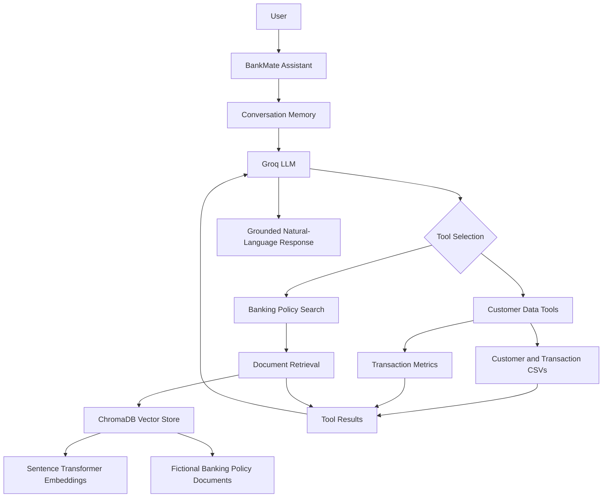

# BankMate — Banking Customer Intelligence Assistant

A conversational banking intelligence assistant built with **LangChain, Groq, and Retrieval-Augmented Generation (RAG)**. BankMate combines structured customer data, transaction analytics, conversational memory, and policy-document retrieval to answer banking-related queries through a single natural-language interface.

> **Project status:** Active development  
> **Data:** Synthetic customer and transaction data; fictional banking policies

---

## Overview

BankMate demonstrates how Large Language Models can interact with structured banking data and unstructured policy documents through a modular tool-based architecture.

Instead of relying on an LLM to generate every answer, BankMate uses dedicated tools to retrieve customer records, calculate transaction metrics, and search relevant policy documents. This helps keep responses grounded in available data and supporting evidence.

## Key Features

- **Conversational AI:** Interact with banking data using natural-language questions.
- **LLM Tool Calling:** The assistant dynamically selects tools based on the user's request.
- **Customer Intelligence:** Retrieve customer profiles and transaction histories.
- **Transaction Analytics:** Calculate debit totals, credit totals, and net transaction flow.
- **Retrieval-Augmented Generation (RAG):** Retrieve relevant information from banking policy documents before generating responses.
- **Semantic Search:** Generate embeddings using Sentence Transformers and store document vectors in ChromaDB.
- **Conversation Memory:** Maintain customer context across follow-up questions within a session.
- **Grounded Responses:** Handle questions outside the available knowledge base without inventing unsupported information.
- **Modular Architecture:** Separate data access, tools, LLM configuration, retrieval, and assistant orchestration.

## Architecture



## Technology Stack

| Category | Technologies |
|---|---|
| Programming Language | Python |
| LLM Framework | LangChain |
| LLM Provider | Groq |
| Language Model | `openai/gpt-oss-20b` |
| Embedding Model | `sentence-transformers/all-MiniLM-L6-v2` |
| Vector Database | ChromaDB |
| Embedding Integration | LangChain Hugging Face |
| Data Processing | Python, CSV |
| Environment Management | Python Virtual Environment, python-dotenv |
| Development Environment | VS Code |

## Project Structure

```text
BankMate/
│
├── app/
│   ├── __init__.py
│   ├── assistant.py          # Assistant orchestration and conversation memory
│   ├── data_loader.py        # Customer and transaction data loading
│   ├── tools.py              # LangChain tools for banking operations
│   ├── llm.py                # Groq model and tool configuration
│   ├── document_loader.py    # Policy document loading and chunking
│   ├── embeddings.py         # Hugging Face embedding configuration
│   ├── vector_store.py       # ChromaDB creation and persistence
│   ├── retriever.py          # Semantic document retrieval
│   └── rag_chain.py          # Retrieval-augmented question answering
│
├── data/
│   ├── customers.csv
│   ├── transactions.csv
│   └── rag_evaluation.csv
│
├── knowledge/
│   └── policies/
│       ├── card_dispute_policy.txt
│       ├── refund_policy.txt
│       └── transaction_security_policy.txt
│
├── chroma_db/                # Locally generated vector database
│
├── main.py                   # Application entry point
├── requirements.txt
├── .env.example
├── .gitignore
└── README.md
```

## How It Works

### 1. Structured Customer Data

BankMate reads customer and transaction records from CSV files.

The customer dataset contains sample customer profiles, while the transaction dataset contains transaction identifiers, dates, types, amounts, and merchant information.

Dedicated tools provide:

- Customer profile retrieval
- Customer transaction history
- Total debit and credit calculations
- Net transaction flow

### 2. LLM Tool Calling

The assistant uses LangChain tool calling to determine which operation is required.

For example:

| User Query | Tool |
|---|---|
| Show customer C101's profile | `get_customer_profile` |
| Show transaction history | `get_customer_transactions` |
| Calculate total debit | `get_customer_metrics` |
| Explain the dispute procedure | `search_banking_policies` |

The LLM interprets the request, invokes the relevant tool, and uses the returned result to formulate its response.

### 3. Retrieval-Augmented Generation

BankMate uses RAG to answer questions about banking procedures.

The document retrieval pipeline:

1. Loads policy documents from the knowledge directory.
2. Splits documents into smaller chunks.
3. Generates vector embeddings using `all-MiniLM-L6-v2`.
4. Stores the embeddings in ChromaDB.
5. Retrieves relevant policy chunks using semantic similarity.
6. Supplies retrieved evidence to the LLM to generate a response.

This allows the assistant to answer questions using the available policy documents rather than relying entirely on the model's pretrained knowledge.

### 4. Conversational Memory

BankMate maintains conversation history within an active application session.

For example:

```text
User: Show me the profile of customer C101.

BankMate: Customer C101 is Arjun Mehta from Mumbai.

User: Show me his transaction history.

BankMate: Retrieves the transaction history for C101.

User: What was his total debit amount?

BankMate: The total debit amount is ₹9,000.
```

The assistant resolves follow-up references using the conversation context and retrieves fresh data when required.

## Getting Started

### Prerequisites

- Python 3.9 or a compatible Python environment
- Git
- VS Code or another Python IDE
- A Groq API key

### 1. Clone the Repository

```bash
git clone https://github.com/Sinon1310/BankMate.git
cd BankMate
```

### 2. Create a Virtual Environment

```bash
python3 -m venv .venv
source .venv/bin/activate
```

### 3. Install Dependencies

```bash
pip install -r requirements.txt
```

### 4. Configure Environment Variables

Create your local environment file:

```bash
cp .env.example .env
```

Add your Groq API key to `.env`:

```env
GROQ_API_KEY=your_groq_api_key
```

Never commit your `.env` file or expose API credentials.

### 5. Build the Vector Store

Generate embeddings and persist the policy documents in ChromaDB:

```bash
python -m app.vector_store
```

Run this again whenever you intentionally rebuild the policy knowledge base.

### 6. Start BankMate

```bash
python main.py
```

Ask questions about the sample customers, their transactions, or the available policy documents.

Type `exit` to close the application.

## Sample Queries

```text
Show me the profile of customer C101.

Show me his transaction history.

What was his total debit amount?

What should a customer do after noticing an unauthorized transaction?

What information is required to raise a card dispute?

How are refunds handled for duplicate transactions?

What is the bank's home loan interest rate?
```

For questions unsupported by the available policy documents, BankMate is designed to acknowledge that the information is unavailable rather than fabricate an answer.

## RAG Evaluation Dataset

The project includes `data/rag_evaluation.csv`, a collection of test questions mapped to expected policy document identifiers.

It covers:

- Card dispute procedures
- Refund processing
- Transaction security
- Questions outside the available policy knowledge base

This dataset provides a foundation for evaluating document retrieval quality and identifying irrelevant retrievals and false negatives.

## Current Scope and Limitations

BankMate is an educational and portfolio project using synthetic data and fictional policy documents.

Current implementation:

- CSV-based customer and transaction data
- Local ChromaDB persistence
- Local sentence-transformer embeddings
- In-memory conversational session history
- Groq-hosted language model
- Basic semantic retrieval with a configurable similarity-distance threshold

It is not connected to a real banking core system, customer account, payment gateway, or production banking infrastructure. It should not be used to process real customer information or financial transactions.

## Future Enhancements

- Automated RAG evaluation using Precision@K and Recall@K
- Improved retrieval quality and relevance filtering
- Conversation persistence and session management
- Structured database integration
- API layer using FastAPI
- Improved observability, logging, and error handling
- Automated testing and evaluation pipelines
- Production-oriented deployment architecture

## Learning Outcomes

This project explores practical applications of:

- LLM orchestration and tool calling
- Retrieval-Augmented Generation
- Semantic search and vector embeddings
- Vector database integration
- Context-aware conversational systems
- Structured and unstructured data integration
- Modular Python application architecture

---

**Developed by [Sinon Christopher Rodrigues](https://github.com/Sinon1310)**

[GitHub Repository](https://github.com/Sinon1310/BankMate)
