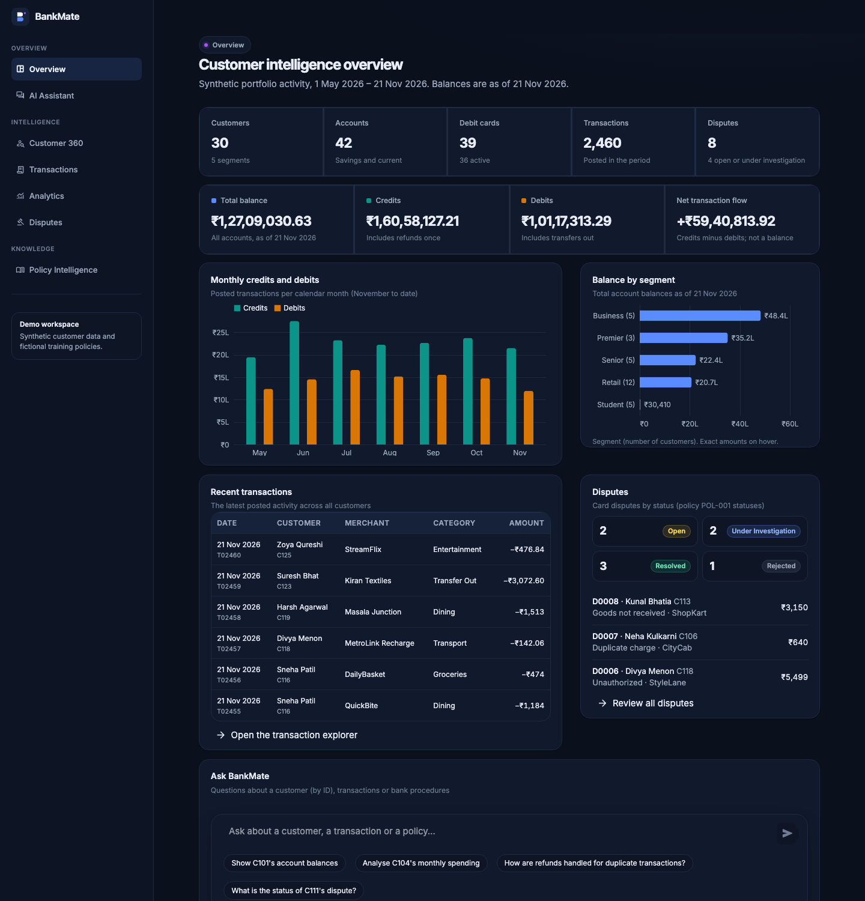
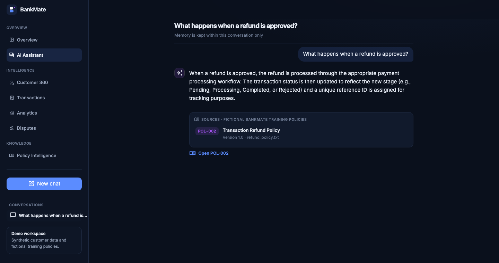
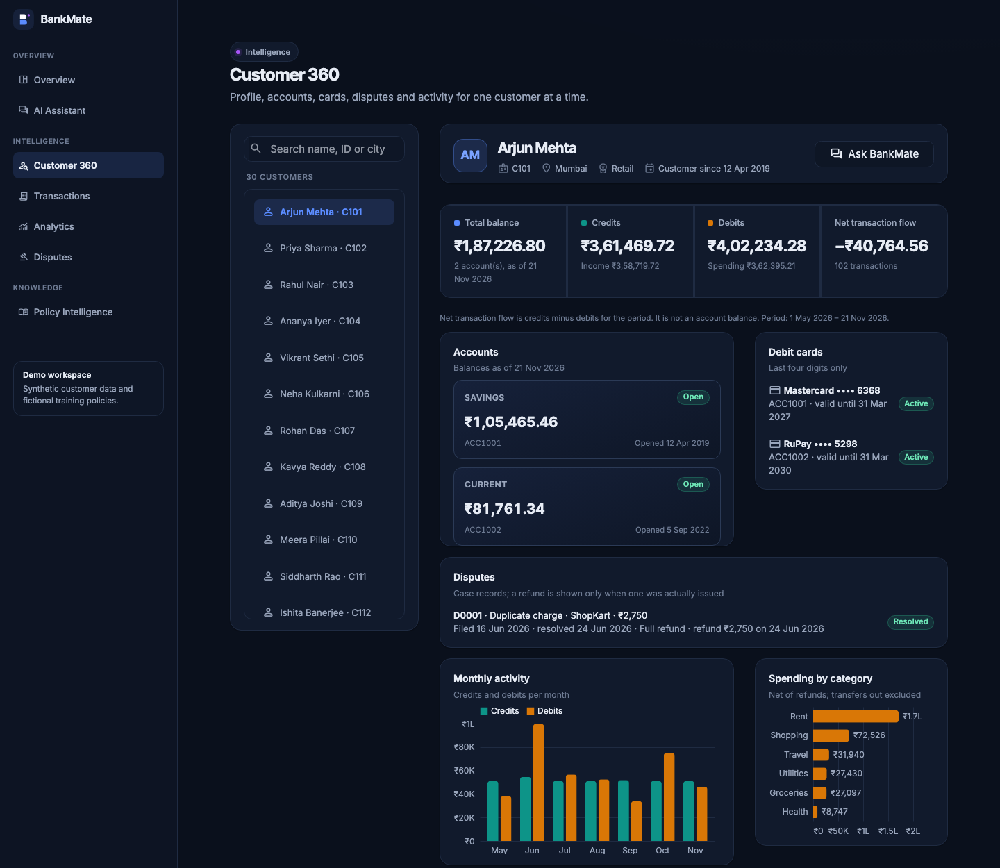
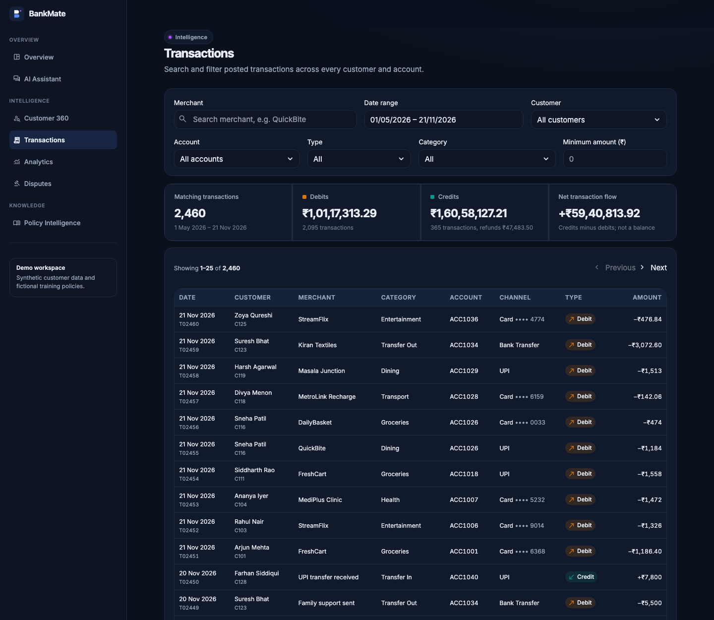
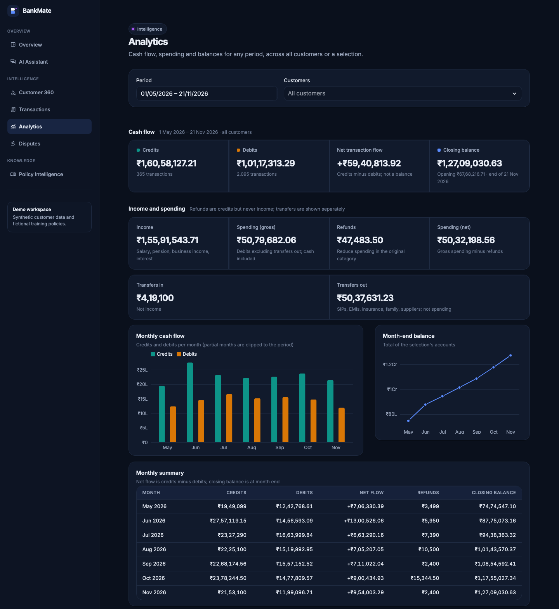
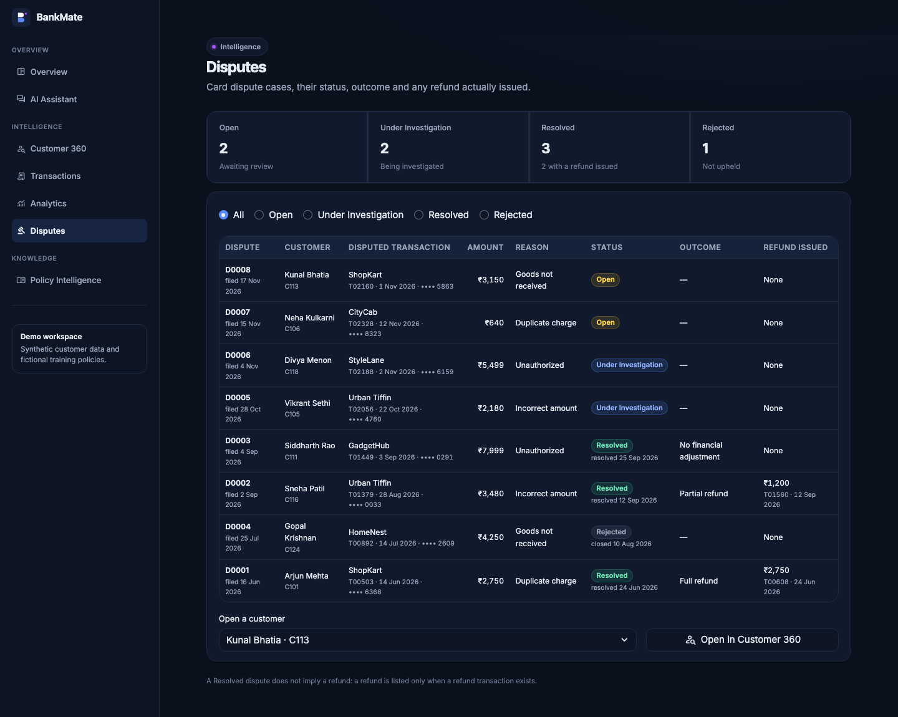
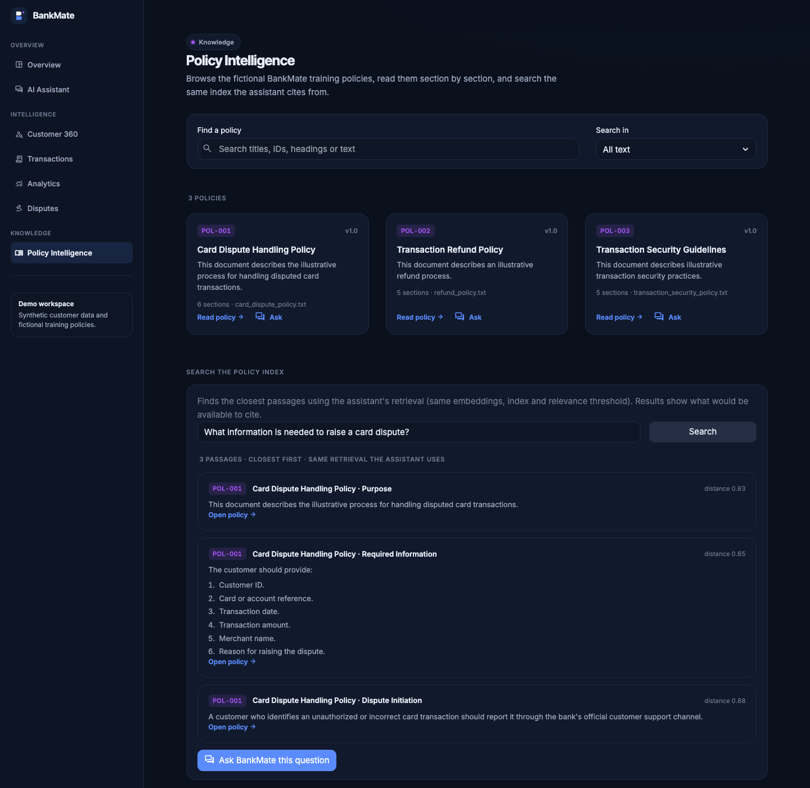
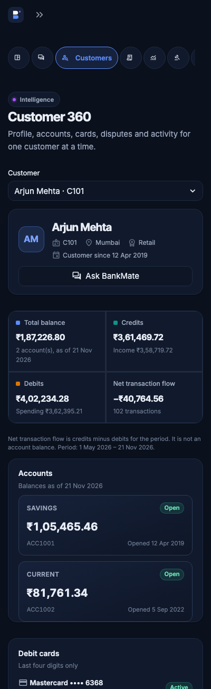
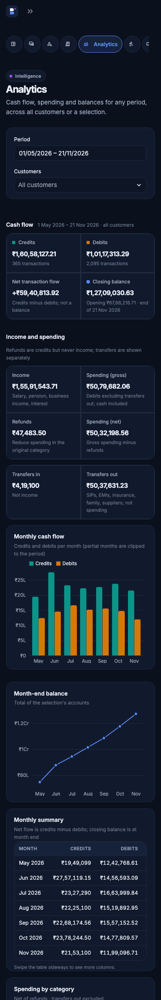
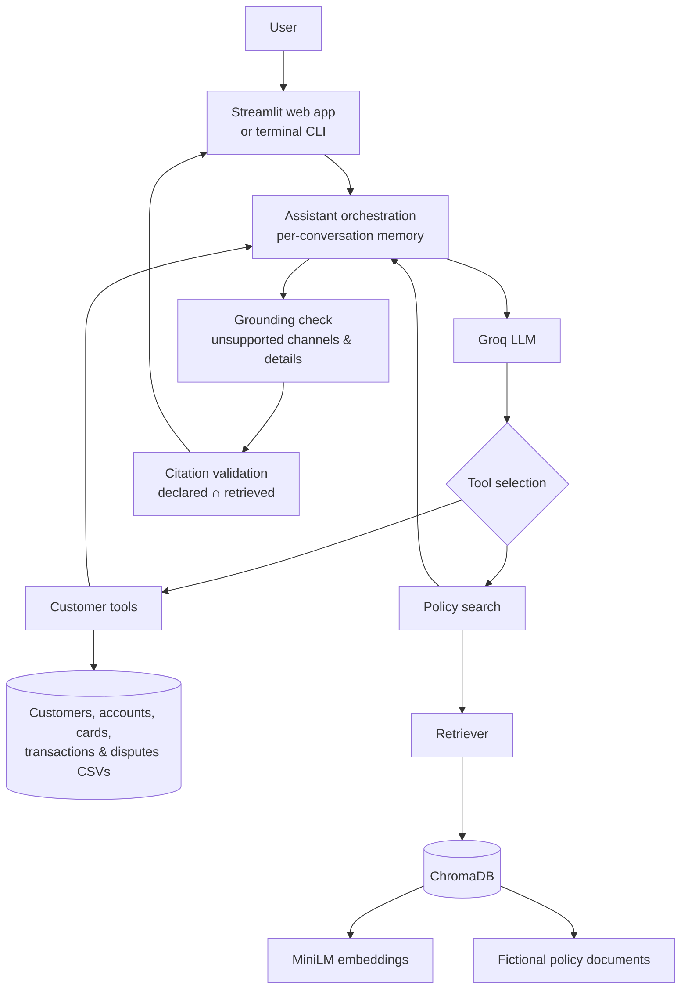

# BankMate — AI Banking Copilot

A conversational banking assistant and customer-intelligence workspace built with **LangChain, Groq and Retrieval-Augmented Generation (RAG)**. BankMate answers questions about customers, accounts, transactions, disputes and bank procedures by calling tools over structured data and retrieving evidence from policy documents. Every policy answer cites the documents it relied on, and those citations are validated against what was actually retrieved.

> **Status:** Active development
> **Data:** Synthetic customers, accounts, debit cards, transactions and disputes; fictional banking policies

<p align="center">
  
</p>

---

## Highlights

- **Web app** — a dark-themed, responsive Streamlit workspace with seven pages:
  - **Overview** — portfolio KPIs, monthly credits and debits, balance by segment, recent transactions and dispute status.
  - **AI Assistant** — multi-conversation chat with validated policy citations.
  - **Customer 360** — one customer's profile, accounts, masked debit cards, disputes, monthly activity, category spending and a filterable, paginated transaction history.
  - **Transactions** — every posted transaction with merchant, date, customer, account, type, category and amount filters, totals for all matches and pagination.
  - **Analytics** — cash flow, income vs spending (gross and net of refunds), transfers, monthly summary, month-end balances, category spending and account summaries for any period and customer selection.
  - **Disputes** — card dispute cases by status, with outcomes and refunds shown only where a refund transaction exists.
  - **Policy Intelligence** — a searchable library of the fictional policies with passage search over the assistant's own index.
- **One set of financial rules** — every figure (balances, credits, debits, income, spending, refunds, transfers, net transaction flow) is defined once in `app/ledger.py` with `Decimal` arithmetic and shared by the assistant's tools and every page. Net transaction flow is always labelled as credits minus debits, never as a balance.
- **Tool calling** — the model reads customer profiles, filtered transactions, period metrics and disputes through validated tools, so figures are computed in Python rather than estimated.
- **RAG over policy documents** — section-aware chunking, Sentence Transformer embeddings and ChromaDB retrieval with a similarity-distance threshold.
- **Validated citations** — the model declares which policies it used; BankMate keeps only IDs that were actually retrieved in that turn, and shows no sources when an answer isn't supported by the policies.
- **Grounding check** — contact channels (phone, chat, branch, email, app…) and procedural details such as where a refund is credited, timeframes or fees that don't appear in the retrieved evidence trigger a revision; if a detail isn't in the policy, the answer says "The policy does not specify …".
- **Isolated conversation memory** — follow-ups such as "what was *his* total debit?" resolve within a conversation; separate conversations never share context.
- **Policy Intelligence** — readable, section-by-section policy pages; passage search over the same index and threshold the assistant cites from; and one-click hand-off to the assistant. Cited sources in the chat open the matching policy.
- **Tested** — offline pytest suite with fake models and tools, plus Streamlit `AppTest` UI tests. No API key needed to run it.

## Screenshots

| AI Assistant with a validated source | Customer 360 |
|---|---|
|  |  |

| Transactions | Analytics |
|---|---|
|  |  |

| Disputes | Policy Intelligence |
|---|---|
|  |  |

| Mobile: Customer 360 | Mobile: Analytics |
|---|---|
|  |  |

## Architecture



### Answer pipeline

1. The model chooses tools; customer tools validate their arguments (`app/tool_args.py`), read the loaded dataset and compute figures with `app/ledger.py`, and `search_banking_policies` retrieves policy chunks within a distance threshold.
2. For policy answers, the model ends its reply with `CITED_POLICIES: POL-xxx` or `CITED_POLICIES: NONE`.
3. **Grounding check** (`app/grounding.py`): contact channels are compared with the retrieved evidence and customer data, and procedural details (where a refund is credited, timeframes, fees) with the retrieved policy evidence. Anything unsupported triggers one revision; an unsupported detail that survives is replaced with "The policy does not specify …".
4. **Citation validation** (`app/citations.py`): declared IDs are intersected with the sources retrieved in that turn. A missing marker or `NONE` yields no sources (fail closed), so fabricated or unused policies are never shown.
5. The UI renders the answer and policy-level sources with the fictional-policy disclaimer.

## Technology stack

| Area | Technology |
|---|---|
| Language | Python 3.9+ |
| LLM orchestration | LangChain |
| LLM provider / model | Groq · `openai/gpt-oss-20b` |
| Embeddings | `sentence-transformers/all-MiniLM-L6-v2` (local, CPU) |
| Vector store | ChromaDB (persisted locally) |
| Web interface | Streamlit (multipage navigation, custom theme) |
| Testing | pytest · Streamlit `AppTest` |

## Project structure

```text
BankMate/
├── app/                       # Backend (UI-independent)
│   ├── assistant.py           # Tool-calling loop, system prompt, per-session memory
│   ├── citations.py           # Citation parsing, validation and formatting
│   ├── grounding.py           # Unsupported contact-channel detection and cleanup
│   ├── tools.py               # LangChain tools: profile, transactions, metrics, disputes, policy search
│   ├── tool_args.py           # Tool argument validation, limits and customer/account scoping
│   ├── ledger.py              # The only definitions of balances, credits, debits, spending and refunds (Decimal)
│   ├── llm.py                 # Groq model and tool binding
│   ├── data_loader.py         # Dataset loading (validated against dataset.json)
│   ├── data_validation.py     # Dataset invariants
│   ├── document_loader.py     # Policy loading and section-aware chunking
│   ├── embeddings.py          # Embedding model configuration
│   ├── vector_store.py        # Policy index lifecycle: validate, build once, reuse
│   ├── retriever.py           # Similarity search with the production k and threshold
│   ├── rag_chain.py           # Standalone single-shot RAG chain
│   ├── evaluate_rag.py        # Retrieval evaluation (Hit@3, Precision@3, section recall, false positives)
│   └── compare_retrieval.py   # Similarity vs MMR comparison
├── ui/                        # Streamlit frontend
│   ├── theme.py               # Design tokens and scoped CSS
│   ├── components.py          # Reusable UI components
│   ├── navigation.py          # Page registry (only implemented pages)
│   ├── state.py               # Conversation store and cross-page prompt hand-off
│   ├── data.py                # Formatting (INR, dates) and legacy read-only data views
│   ├── insights.py            # Dataset-wide figures for Overview, Transactions, Analytics, Disputes (via app.ledger)
│   ├── index_status.py        # Policy index readiness at startup, with rate-limited retries
│   ├── charts.py              # Altair charts in the design system
│   ├── policy_data.py         # Policy catalogue, keyword search and passage retrieval (reuses the RAG tool)
│   ├── assets/                # Logo
│   └── views/                 # home.py (Overview), assistant.py, customers.py (Customer 360),
│                              # transactions.py, analytics.py, disputes.py, policies.py
├── tests/                     # Offline backend and UI tests
├── scripts/generate_data.py   # Deterministic synthetic dataset generator
├── data/                      # Synthetic dataset (5 CSVs + dataset.json manifest), RAG evaluation set
├── knowledge/policies/        # Fictional policy documents
├── docs/screenshots/
├── .streamlit/config.toml     # Dark theme and error-detail settings
├── streamlit_app.py           # Web app entry point
├── main.py                    # Terminal chat entry point
├── requirements.txt
└── requirements-dev.txt
```

## Getting started

### Prerequisites

- Python 3.9 or later
- A [Groq API key](https://console.groq.com/)

### Setup

```bash
git clone https://github.com/Sinon1310/BankMate.git
cd BankMate

python3 -m venv .venv
source .venv/bin/activate

pip install -r requirements.txt
cp .env.example .env            # then set GROQ_API_KEY in .env
```

The policy vector index (`chroma_db/`) is built automatically on first launch and reused afterwards. It is validated on every start and rebuilt only when it is missing, incomplete or out of date with the policy files. To force a rebuild:

```bash
python -m app.vector_store
```

### Run the web app

```bash
streamlit run streamlit_app.py
```

Open http://localhost:8501. If `GROQ_API_KEY` is missing, Overview, Customer 360, Transactions, Analytics, Disputes and Policy Intelligence (including passage search) still work; only the assistant shows an "unavailable" state.

If the policy index can't be prepared at startup, the AI Assistant and Policy Intelligence pages show a banner and the other pages keep working. The app retries automatically (at most every 30 seconds), so a temporary problem clears without a restart; the full error is in the server log.

### Optional settings

These environment variables (or Streamlit secrets) tune the conversation engine; the defaults suit Groq's free tier.

| Variable | Default | Purpose |
|---|---|---|
| `BANKMATE_LLM_TIMEOUT_SECONDS` | `30` | Fail a stalled model request instead of hanging the UI |
| `BANKMATE_LLM_MAX_RETRIES` | `1` | Client-level retries (honours `Retry-After` on rate limits) |
| `BANKMATE_MAX_HISTORY_TURNS` | `6` | Recent question/answer turns kept per conversation |
| `BANKMATE_SESSION_TTL_SECONDS` | `86400` | Idle conversations are dropped from memory after this |
| `BANKMATE_MAX_TRANSACTION_LIMIT` | `50` | Most transactions one tool call may return (1–100); totals always cover every match |
| `BANKMATE_DATA_DIR` | `data/` | Dataset folder (relative paths resolve against the project root) |
| `BANKMATE_INDEX_AUTOINIT` | `1` | Set to `0` to skip preparing the policy index at web-app startup (used by the tests) |

### Dataset

`data/` holds a deterministic synthetic dataset (1 May – 21 Nov 2026, INR): 30 customers, 42 savings and current accounts, 39 debit cards (last four digits only), 2,460 transactions and 8 card disputes, plus `dataset.json` with row counts, recorded closing and month-end balances and SHA-256 hashes of every file. It is validated on load; an invalid dataset stops the app rather than falling back to other data. Regenerate it with `python -m scripts.generate_data --output-dir <folder>`.

Financial rules (all in `app/ledger.py`): balances are opening balance plus credits minus debits; refunds are separate credits that reduce spending in the original category but are never income; transfers in and out are neither income nor spending; net transaction flow is credits minus debits and is never presented as a balance.

### Run the terminal chat

```bash
python main.py                  # type 'exit' to quit
```

## Example questions

```text
Show me the profile of customer C101.
What was his total debit amount?
What were C102's credits and debits in October 2026?
What is the status of C111's dispute?
What should a customer do about an unauthorized transaction?
What information is needed to raise a card dispute?
How are refunds handled for duplicate transactions?
What is the bank's home loan interest rate?     ← not covered: answered without sources
```

## Testing and evaluation

```bash
pip install -r requirements-dev.txt
python -m pytest -q
```

The suite runs offline: the assistant is exercised with scripted fake models and tools, and UI flows run through Streamlit's `AppTest` with a fake backend. It covers the ledger rules and dataset invariants, tool argument validation and customer scoping, every page on the full generated dataset, citation selection, duplicate and missing metadata, unsupported questions, grounding and cleanup, conversation isolation, retry and unavailable states, analytics totals cross-checked against the metrics tool, and the policy catalogue checked against the raw policy files. Policy passage search is tested with a fake retrieval tool, so ChromaDB isn't required.

Retrieval quality is measured separately against `data/rag_evaluation.csv`: 38 questions across direct, paraphrased, section-specific, multi-section and ambiguous policy questions, plus out-of-scope and near-miss questions. It uses the production k and distance threshold and no LLM calls:

```bash
python -m app.evaluate_rag          # Hit@3, Precision@3, section recall, false-positive rate, threshold sweep
python -m app.compare_retrieval     # Similarity vs MMR ranking
```

Current results (k=3, threshold 1.2): Hit@3 0.931, Precision@3 0.859 and section recall 0.786 on 29 policy questions; false-positive rate 0.111 on 9 out-of-scope and near-miss questions.

## Security notes

BankMate uses synthetic data and fictional policies. The controls below are sensible defaults for a portfolio deployment; they are not a security certification and BankMate makes no claim of compliance with PCI DSS, RBI guidelines or any other regulatory framework.

- **Secrets** — the Groq key is read from `.env` locally or the host's secrets in deployment; `.env`, Streamlit secrets, key files, logs and the local index are git-ignored. A missing, placeholder or malformed key fails fast with a message that never includes the value, and key-like strings are redacted from logs and errors.
- **Untrusted content** — user input and retrieved policy text are treated as data. Policy results are labelled as untrusted reference text, and the system prompt forbids following instructions inside them.
- **Customer-data scope** — the assistant can only look up customers whose IDs you type in the current conversation (e.g. `C101`); a lookup requested by retrieved text or for an unnamed customer is refused before any data is read. Refer to customers by ID.
- **Tools** — the model can only call five read-only tools (profile, transactions, metrics, disputes, policy search). Arguments are validated against fixed schemas and limits; an account filter must belong to the authorised customer, other identifiers (card, transaction IDs) are rejected, and raw values are never echoed back. There is no file, shell or network access.
- **Input and output** — questions are limited to 2,000 characters and stripped of control characters; links, images and URLs are neutralised in answers before display.
- **Errors** — tracebacks are not shown in the browser (`showErrorDetails = "none"`); users see friendly messages while details go to the server log.
- **Sessions** — conversations are isolated by random IDs and held only in server memory (lost on restart, expired after 24 hours idle). There are no user accounts or authentication; anyone with the URL can use the app, so put it behind access control before sharing it.
- **Dependencies** — a `pip-audit` scan of the current environment reports known advisories in several packages (including transitive ones such as Pillow, torch and transformers). Their fixes require Python 3.10+, so they are addressed together with the planned move off Python 3.9 rather than by piecemeal upgrades.

## Scope and limitations

BankMate is an educational and portfolio project. It uses synthetic data and fictional policy documents and is not connected to any banking system. It must not be used with real customer information or financial transactions.

- Banking data are CSV files; conversation memory is in-process, keeps the most recent turns, and resets when the app restarts or a conversation is idle for 24 hours.
- The assistant identifies customers by ID only (it will ask for an ID rather than guess one from a name).
- Citations are policy-level; the model does not report which sections it relied on.
- Citations come only from policies retrieved in the same answer, so a follow-up answered from earlier results (without a new search) shows no Sources card.
- The code-level grounding check covers contact channels and specific procedural details (refund destination, timeframes, fees); other unsupported claims rely on the system prompt's policy-grounding rules.

## Roadmap

- Persistent conversations and structured database storage
- API layer and deployment configuration

---

**Developed by [Sinon Christopher Rodrigues](https://github.com/Sinon1310)**
